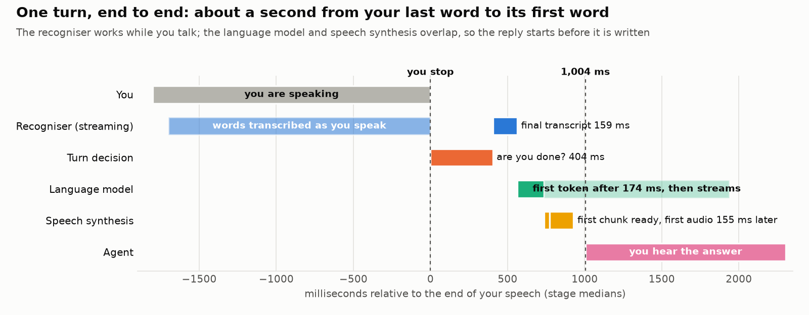
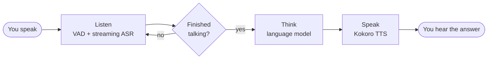
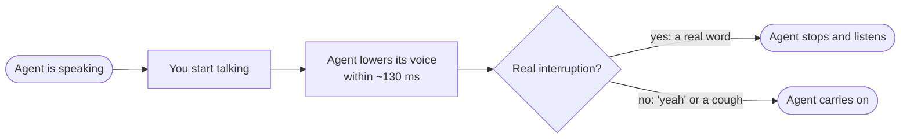

<div align="center">

# Voice Agent

### Talk to it like a person. It answers in about a second, and you can interrupt it.

A real-time spoken conversation agent whose speech recognition and speech synthesis run on a **4 GB laptop GPU**,<br/>engineered for low latency, natural turn-taking and interruption, and measured end to end.


<table>
<tr>
<td align="center" width="25%"><h2>~1.0 s</h2>from your last word<br/>to its first word<br/><sub>voice-to-voice p50</sub></td>
<td align="center" width="25%"><h2>129 ms</h2>to yield when<br/>you talk over it<br/><sub>voice ducks, p50</sub></td>
<td align="center" width="25%"><h2>2.3 GiB</h2>GPU memory for<br/>recognition + speech<br/><sub>of a 4 GB laptop GPU</sub></td>
<td align="center" width="25%"><h2>0 / 6</h2>false stops on<br/>"yeah" and coughs<br/><sub>scripted tests</sub></td>
</tr>
</table>

<!-- Demo: drop a 20-40 s screen recording (asking, then interrupting it mid-answer) into a GitHub issue and paste the video URL on the next line. -->

</div>

---

You talk; it transcribes **while you speak**, decides when you have actually **finished** (not just paused), asks a language model and **starts speaking before the answer is fully written**. Talk over it and its voice **ducks within ~130 ms**: if you really meant to interrupt it stops, cancels the rest and remembers only what you heard; if you just said "yeah", it carries on. Use it in a browser on the laptop, or share a link and talk to it from a phone on any network.

The language model is a plug-in. **The engineering here is everything around it**: listening, turn-taking, streaming speech in and out, interruption, and keeping all of it real-time on a GPU small enough that the speech models fight over it.

## Contents

[Results](#results) · [How it works](#how-it-works) · [Engineering](#engineering-problems-fixes-impact) · [Swappable parts](#swappable-parts) · [Constraints and headroom](#hardware-constraints-and-headroom) · [Quick start](#quick-start) · [Measuring](#measuring) · [Layout](#repository-layout)

## Results

<picture><source media="(prefers-color-scheme: dark)" srcset="docs/assets/turn-timeline-dark.png"></picture>

| Measured on the same 30 recordings, replayed in real time | First working version | Now | Change |
|---|---:|---:|---:|
| **Voice-to-voice**, p50 (you stop, it starts) | 1,106 ms | **1,004 ms** | **-9%** |
| **Voice-to-voice**, p90 | 1,635 ms | **1,427 ms** | **-13%** |
| Sentence cut in two by an early commit | 27% | **17%** | -10 pts |
| Last word lost or misheard | 30% | **23%** | -7 pts |
| Word error rate | 9.7% | **8.9%** | -0.8 pts |
| LLM first token, p50 / p90 | 243 / 610 ms | **174 / 492 ms** | -28% / -19% |
| Recogniser speed while the agent talks (real-time factor) | 1.28, falls behind | **0.42** | **3x headroom** |
| Agent yields when you interrupt | did not | **129 ms** | new |
| False stops on "yeah", "mm-hmm" or a cough | 0 of 6 | **0 of 6** | kept |


<sub>RTX 3050 Laptop 4 GB, Windows 11, LLM via OpenRouter from India. Public recordings (Common Voice Indian-accent speakers, AI4Bharat Svarah, LibriSpeech), not the author's voice. n, method, run-to-run variation and every experiment: <a href="docs/benchmarks.md">docs/benchmarks.md</a>.</sub>

## How it works



1. **Listen.** Your speech is transcribed on the GPU *while* you talk.
2. **Decide you are finished.** Silence rules plus a small turn model tell a pause from the end of a sentence.
3. **Think.** A language model (swappable, in the cloud) streams its answer.
4. **Speak early.** The first few words are turned into speech before the rest of the answer is written.

**Interrupting it:**



Per-block deep dive (listening state machine, the never-falling-behind recogniser, the hedged LLM call, speech output, concurrency on one GPU): **[docs/architecture.md](docs/architecture.md)**.

## Engineering: problems, fixes, impact

Every fix below came from a measured failure, mostly in live conversations, and was kept only if a before/after on the same recordings showed it helped.

| Problem | Fix | Measured impact |
|---|---|---|
| The recogniser fell behind real time whenever the agent spoke: 53 s of backlog in one long live conversation | 560 ms chunks; queued audio of a discarded utterance is purged, not decoded; new speech synthesis pauses while you interrupt | real-time factor under TTS load **1.28 -> 0.42** |
| ~1.7 s lost on every turn | one long-lived decode thread (cuDNN keeps its plans per thread) | per-turn start-up gone |
| The laptop GPU idled at 250-700 MHz under small kernels | locked clocks (`nvidia-smi -lgc`) | **1.14 -> 0.77** at 160 ms |
| torch used all cores and starved the audio threads | 2 CPU threads for torch | **0.75 -> 0.52** |
| It answered at commas ("Tell me an amazing" ... "fact") | commit after 300 ms of silence; if you keep talking, the whole turn is re-recognised together | sentence splits **27% -> 17%** |
| Soft last words vanished ("Who are [you]") | the recogniser hears the whole end-of-turn wait, then a two-chunk flush | right last word **126 -> 130 of 150** (ideal 131) |
| The agent talked over you for 0.5-3 s | duck after 150 ms of speech, then let the words decide | yields in **129 ms**, 0 of 6 false stops |
| One network stall timed out three models in a row (7.5 s) | hedged call: a second model starts after 0.8 s, first to speak wins | p90 first token **0.24 s** with the chosen providers |
| A shared link on a phone had no audio and no transcript | audio and events over WebSockets inside the tunnel, adaptive jitter buffer | works from any network |


Why each choice was made: [docs/design-decisions.md](docs/design-decisions.md).

## Swappable parts

| Stage | Default | Runs on | Swap with |
|---|---|---|---|
| **Language model ("brain")** | Llama 3.3 70B via OpenRouter (Groq, then CoreWeave); hedged fallback to Llama 3.1 8B and GPT-4.1 Nano | cloud | any OpenRouter model in `configs/default.yaml`, or a class implementing `ChatModel` (a local server, another API) |
| Speech recognition | [Nemotron Speech Streaming EN 0.6B](https://huggingface.co/nvidia/nemotron-speech-streaming-en-0.6b), fp16 | GPU | an adapter implementing `StreamingASR` |
| Speech synthesis | [Kokoro-82M](https://huggingface.co/hexgrad/Kokoro-82M), voice `af_heart` | GPU | an adapter implementing `SpeechSynthesizer` |
| End of turn | [Smart Turn v3.2](https://github.com/pipecat-ai/smart-turn) + silence rules | CPU | `turn.detector: silence`, or another `TurnDetector` |
| Voice activity | [Silero VAD](https://github.com/snakers4/silero-vad) | CPU | another `VoiceActivityDetector` |
| Transport | WebRTC ([FastRTC](https://github.com/gradio-app/fastrtc)) on the laptop; WebSocket through the shared link | | a module in `transport/` |

The pipeline depends only on the protocols in [`core/interfaces.py`](src/voiceagent/core/interfaces.py); each model library is imported in exactly one adapter. Every behaviour is a config switch with a UI control, so any technique can be turned off and measured.

## Hardware, constraints and headroom

Built and measured on an **NVIDIA RTX 3050 Laptop GPU (4 GB)**, 16 GB RAM, native Windows 11.

| Constraint | What it forced |
|---|---|
| 4 GB for recognition and synthesis together | 0.6B + 82M models in fp16, no LLM on the GPU |
| Both speech models share one GPU | 560 ms recognition steps; synthesis pauses while you interrupt |
| Laptop GPU idles its clocks under small kernels | clocks locked once per boot |
| Cloud LLM from India | 0.2 s first token at best, with spikes; hedged calls |
| Indian-accented English | word error rate ~5% on clean US speech, ~10% on Indian-accented read speech, 19-21% on Svarah |

**What more resources would buy** (estimates, not measured):

| With | Expected benefit |
|---|---|
| A second GPU or 8+ GB | 160 ms recognition steps stay real-time: words appear ~3x sooner, interruptions confirm ~300-400 ms faster |
| An Indian-English recogniser, e.g. [Bodhan AI Indic-Transcribe](https://huggingface.co/bodhan-ai/indic-transcribe-core) (1.2B, 1.3M hours of Indian speech), as a second pass per turn | the biggest likely accuracy gain for Indian accents and code-mixed speech, for ~0.2-0.4 s |
| A streaming cloud recogniser such as Sarvam Saaras v3 (usable today) | accent accuracy without local compute, at a per-minute cost and a network hop |
| 16-24 GB for a local LLM | no network wait or spikes, at some quality cost versus a 70B model |
| Indic speech synthesis (Bodhan Indic-Speak, Sarvam Bulbul) | an Indian voice and Hindi replies |

## Quick start

Windows 11 (PowerShell), an NVIDIA GPU with 4 GB or more, Python 3.12, an [OpenRouter](https://openrouter.ai) key and a [Hugging Face](https://huggingface.co) token.

```powershell
git clone <your-repo-url> voice-agent; cd voice-agent
uv venv --python 3.12 .venv
uv pip install --python .venv\Scripts\python.exe torch torchaudio --index-url https://download.pytorch.org/whl/cu126
uv pip install --python .venv\Scripts\python.exe -e ".[models,ui,dev]"
copy .env.example .env          # add OPENROUTER_API_KEY and HF_TOKEN
.\.venv\Scripts\python.exe scripts\probe_gpu.py           # checks the GPU and libraries
.\.venv\Scripts\python.exe -m voiceagent.ui.app --smoke    # one spoken turn through the real models, offline
.\.venv\Scripts\python.exe -m voiceagent.ui.app            # open http://127.0.0.1:7860
```

The first start downloads the models (about 6 GB); later starts take about 20 s. Use headphones: on laptop speakers the agent can hear itself (turn on `barge_in.echo_guard`).

<details>
<summary><b>Talk to it from a phone or another computer</b></summary>

Download [`cloudflared`](https://developers.cloudflare.com/cloudflare-one/connections/connect-networks/downloads/), put `cloudflared.exe` next to `.venv\Scripts\python.exe`, then:

```powershell
.\.venv\Scripts\python.exe -m voiceagent.ui.app --share
```

It prints a temporary `https://….trycloudflare.com` link that works from any network until you press Ctrl+C. Anyone with the link can talk to the agent and spend your API credit.
</details>

<details>
<summary><b>Faster recognition on laptop GPUs</b></summary>

Laptop GPUs keep low clocks under the recogniser's many small kernels. In an Administrator PowerShell, after each reboot:

```powershell
nvidia-smi -lgc 1500,1500
```
</details>

<details>
<summary><b>The settings you are most likely to change</b></summary>

Every behaviour is a key in [`configs/default.yaml`](configs/default.yaml) and a control in the page's settings drawer, each with an explanation.

| Key | Default | Meaning |
|---|---|---|
| `llm.model`, `llm.provider_order` | Llama 3.3 70B, `[groq, coreweave]` | which model answers and who serves it |
| `tts.voice`, `tts.speed` | `af_heart`, 1.0 | Kokoro voice |
| `turn.min_silence_ms`, `turn.max_silence_ms` | 300, 900 | how long to wait before deciding you have finished |
| `barge_in.min_speech_ms`, `barge_in.backchannel_max_ms` | 150, 700 | how quickly it yields, and what counts as "yeah" |
| `barge_in.echo_guard` | off | turn on with laptop speakers |
| `asr.chunk_ms` | 560 | recognition step: 160 is faster but needs GPU headroom |
| `ui.transport` | auto | WebRTC on the laptop, WebSocket through the shared link |
</details>

## Measuring

```powershell
python scripts\fetch_eval_audio.py                                       # public test speech
python scripts\run_eval.py --set listening --n 30 --tag base             # accuracy and latency
python scripts\run_eval.py --set interruptions --n 3 --tag barge         # yielding and false stops
python scripts\run_eval.py --set listening --n 30 --tag wait --compare turn.min_silence_ms=300 --compare turn.min_silence_ms=500
python scripts\plot_results.py                                           # redraws every chart from docs/results.json
```

The harness replays recordings through real sessions at real time and compares conditions on the same inputs, interleaved. `bench_asr.py`, `bench_tts.py`, `bench_llm.py` and `bench_coresident.py` measure single components; `record_utterances.py` records your own voice to test accuracy on your accent. Everything tried, kept and dropped: [docs/benchmarks.md](docs/benchmarks.md).

## Repository layout

```
configs/default.yaml        every switch and threshold
prompts/persona.md          the assistant's spoken style
src/voiceagent/
  core/                     contracts (interfaces), timing trace, event names, text metrics
  audio/                    resampling, framing, pre-roll, Silero VAD, Smart Turn
  asr/                      Nemotron streaming adapter
  llm/                      OpenRouter client, hedged race, persona, length policy, chunker, normaliser
  tts/                      Kokoro adapter
  pipeline/                 session state machine, listening, endpointing, speculation, ASR stage,
                            reply flow, barge-in, playout, history, trace log, component factory
  transport/                WebRTC (FastRTC), WebSocket, offline replay
  ui/                       FastAPI server, session host, event hub, settings catalog, tunnel, web page
  eval/                     replay harness behind scripts/run_eval.py
scripts/                    benchmarks, evaluation, data fetch, recording, charts
evals/sets/                 public clip manifest, interruption scenarios, read-aloud prompts
tests/                      358 unit tests (no GPU or network) and marked integration tests
docs/                       architecture, benchmarks, design decisions, charts
```

## Acknowledgements

NVIDIA [Nemotron Speech Streaming](https://huggingface.co/nvidia/nemotron-speech-streaming-en-0.6b) (NVIDIA Open Model License), [Kokoro-82M](https://huggingface.co/hexgrad/Kokoro-82M) (Apache 2.0), [Smart Turn](https://github.com/pipecat-ai/smart-turn) (BSD 2-Clause), [Silero VAD](https://github.com/snakers4/silero-vad) (MIT), [FastRTC](https://github.com/gradio-app/fastrtc), [OpenRouter](https://openrouter.ai). Evaluation speech: [Common Voice](https://commonvoice.mozilla.org) (CC0), [AI4Bharat Svarah](https://huggingface.co/datasets/ai4bharat/Svarah) (CC BY 4.0), [LibriSpeech](https://www.openslr.org/12) (CC BY 4.0). Model weights and datasets are downloaded at run time and keep their own licences.

## License

[MIT](LICENSE) © 2026 Kuldeep
