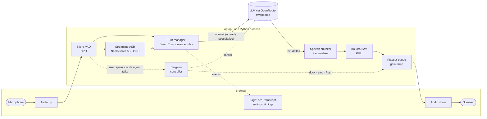
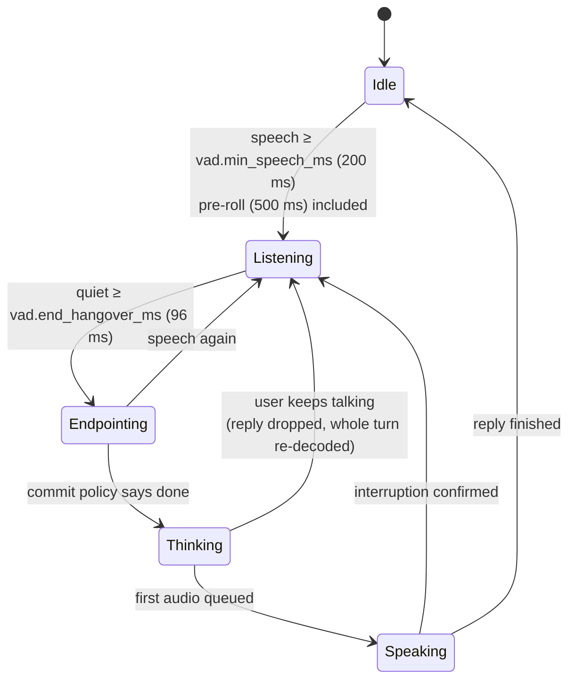
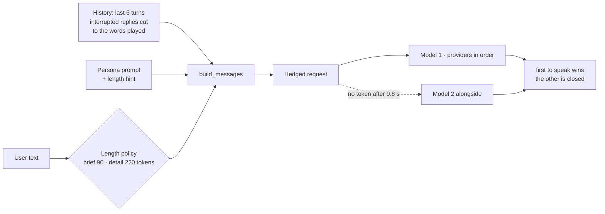
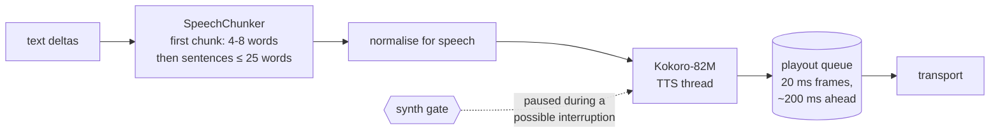
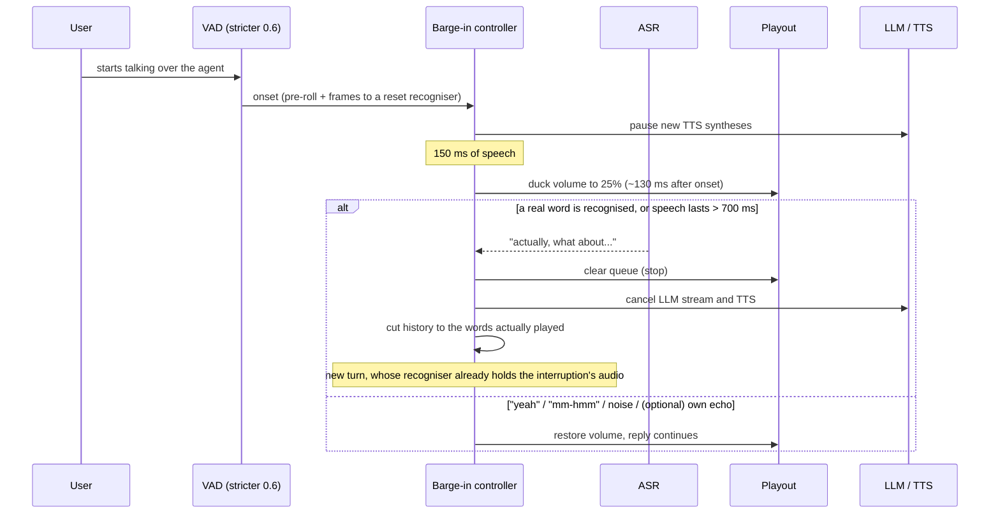
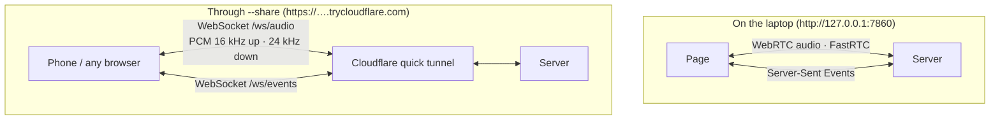

# Architecture

The goal: the shortest time from the user's last word to the agent's first sound, without talking over the user, cutting them off, or answering a different question, on a laptop GPU with 4 GB of memory. The language model is a swappable part; the engineering is in listening, speaking, interruption and keeping everything real-time.

- [1. Overview](#1-overview)
- [2. Listening: from microphone to a finished turn](#2-listening-from-microphone-to-a-finished-turn)
- [3. Streaming recognition that never falls behind](#3-streaming-recognition-that-never-falls-behind)
- [4. The brain: a swappable language model](#4-the-brain-a-swappable-language-model)
- [5. Speaking: from text deltas to audio frames](#5-speaking-from-text-deltas-to-audio-frames)
- [6. Interruptions: duck, then decide](#6-interruptions-duck-then-decide)
- [7. Transports: on this machine and from anywhere](#7-transports-on-this-machine-and-from-anywhere)
- [8. Concurrency and the GPU](#8-concurrency-and-the-gpu)
- [9. Observability and evaluation](#9-observability-and-evaluation)
- [10. Swapping components](#10-swapping-components)
- [11. Code layout](#11-code-layout)

## 1. Overview



Every stage stamps a timestamp into a per-turn trace (`core/metrics.py`); the page, the trace log and the evaluation harness read the same numbers.

## 2. Listening: from microphone to a finished turn

Audio arrives at any sample rate, is resampled to 16 kHz and cut into 32 ms frames. Each frame goes through Silero VAD (about 0.3 ms on the CPU). The turn state machine decides what the frame means:



**Commit policy** (`pipeline/turn_manager.py`, `pipeline/endpointing.py`). After the user goes quiet:

| Situation | Commit after |
|---|---|
| Smart Turn says "finished" (probability ≥ 0.7) | `turn.min_silence_ms` (300 ms) |
| Smart Turn says "not finished" (≤ 0.3) or the transcript ends in a hold word (and, but, so, um...) | up to `turn.max_silence_ms` (900 ms) |
| In between | about halfway |
| `turn.detector: silence` (baseline) | fixed 500 ms |

**Hearing the turn to the end.** Three details keep the last word:
1. The recogniser receives the whole turn including the endpointing wait (`vad.gate_asr: false`), so a soft last syllable the VAD scored as silence is still transcribed.
2. After the commit, real microphone audio keeps flowing to the recogniser until `asr.tail_ms` (160 ms) of post-speech audio has been heard, counted against the pause that already happened, and then two silent chunks flush its lookahead (`asr.flush_chunks: 2`).
3. If the user resumes after a commit, the reply is dropped and the *whole* turn (old and new audio) is re-recognised together, instead of starting a fresh utterance with no context, which lost words at the pause.

**Speculative start** (`pipeline/speculation.py`). When the partial transcript has been stable for one recogniser chunk and 200 ms of silence have passed, the LLM request starts early and its text is buffered. If the final transcript matches, the buffer is released at once; otherwise the speculative stream is cancelled. Hits and wasted requests are counted per turn.

## 3. Streaming recognition that never falls behind

```mermaid
flowchart LR
    F[32 ms frames] --> Q[AsrStage queue<br/>tagged by utterance]
    Q -->|"stale utterance? skip"| X((discard))
    Q --> W[One long-lived<br/>decode thread]
    W --> M[Nemotron generate&#40;&#41;<br/>cache-aware, 560 ms chunks]
    M --> P[partial transcript] --> T[turn manager · UI]
    W -.-> L[backlog in ms<br/>→ asr_lag event]
```



Nemotron runs through Hugging Face Transformers as a `generate()` call that pulls exact-size mel chunks from a generator; `asr/nemotron.py` feeds that generator from a queue and returns the current partial after each push.

The live session first ran the recogniser slower than real time: at 160 ms chunks its real-time factor was 0.43 alone but 1.28 while the TTS synthesised, and in a long conversation its queue grew to 53 s. The fixes, each measured:

| Fix | Effect |
|---|---|
| One long-lived decode thread (cuDNN plans are per thread) | removed ~1.7 s of per-turn set-up |
| torch limited to 2 CPU threads | real-time factor 0.75 -> 0.52 |
| GPU clocks locked (the small kernels never raised them) | 1.14 -> 0.77 at 160 ms |
| 560 ms chunks | 0.42 even while TTS runs; also more accurate on accented speech |
| Queue items tagged by utterance; a reset purges old audio instead of decoding it | no wasted GPU time after an interruption or a restart |
| New TTS syntheses pause while the user talks over the agent | the recogniser gets the GPU when it matters |

## 4. The brain: a swappable language model

The pipeline depends only on a small protocol (`core/interfaces.py`):

```python
class ChatModel(Protocol):
    def stream(self, messages: list[dict[str, str]], *, max_tokens: int,
               cancel: asyncio.Event) -> AsyncIterator[str]: ...
```

`llm/openrouter.py` implements it for any OpenRouter model. Around it:



- **Routing**: `llm.provider_order` (Groq, then CoreWeave) and `routing_sort: latency`. Routing mattered more than model size: the same 70B model had a first-token p50 of 0.20 s via Groq and 0.37 s via CoreWeave.
- **Hedged fallback**: after `hedge_after_s` (0.8 s) without a token, the next model starts alongside; an attempt that fails (429, 5xx, network) starts the next at once. Each call keeps its own result (model, provider, timing, usage) so a speculative request and the real one never overwrite each other.
- **Brevity in code, not only in the prompt**: a regex over the user's words picks brief or detail mode; a reply cut by the token limit is trimmed at its last sentence end so a half sentence is never spoken.
- **Speech hygiene**: stage directions ("(pauses)", "*smiles*") and markdown are removed before synthesis; numbers, rupee and dollar amounts, percentages and abbreviations are spelled out.

## 5. Speaking: from text deltas to audio frames



The first chunk ends at the first clause boundary after four words (or is forced at eight), so audio starts as soon as possible; Kokoro produces an 8-word chunk's first audio in 153 ms (p50). Chunk n+1 is synthesised while chunk n plays. The playout queue stays about 200 ms ahead of what has been sent, so clearing it is instant, and applies a gain ramp used for ducking.

## 6. Interruptions: duck, then decide



Measured: the agent audibly yields 129 ms (p50) after voice activity, stops at about 0.67 s, and was not stopped by "yeah", "mm-hmm", "okay" or a cough in the scripted tests. Every frame of the interruption, including the 500 ms pre-roll and the words spoken while a backchannel check runs, reaches the new turn exactly once, so the interrupting sentence is transcribed in full.

## 7. Transports: on this machine and from anywhere



The page picks the transport itself (`ui.transport: auto`). WebRTC has the lowest latency locally, but its media cannot pass an HTTP tunnel and needs a TURN relay off the local network. Through the shared link the page instead streams PCM over a WebSocket: the server paces frames in real time, AudioWorklets capture and play audio in the browser, and an adaptive jitter buffer (60-300 ms) absorbs the tunnel's 200-250 ms delivery gaps and is emptied at once on an interruption. Session events also move to a WebSocket there, because the tunnel buffered the event stream completely.

The page itself: an orb drawn on a canvas, driven by WebAudio analysers of the microphone and of the agent's voice (60 fps, no server traffic), one Start/Stop button, a chat-style live transcript, a settings drawer generated from `ui/control_catalog.py` with an explanation per switch, and a Performance panel with the stage timings of each turn.

## 8. Concurrency and the GPU

- **One process, one CUDA context** shared by the ASR and the TTS. Both models stay resident and are warmed up at start; a residency check fails loudly if any parameter is not on the GPU (no CPU offload anywhere). Peak: 2.30 GiB of 4 GiB.
- **An asyncio loop** owns the state machine, the LLM stream and the transport queues. Blocking GPU work runs in dedicated single-thread executors (ASR, TTS, turn model), so a slow call never blocks audio intake.
- **Every queue is bounded**; event fan-out to browsers drops old level events rather than growing.
- **Audio time, not wall time**, drives the state machine (silence is counted in frames received), so replays faster than real time behave like live sessions; wall time is used only for the trace marks.

## 9. Observability and evaluation

Each turn writes one JSON line (`evals/results/traces/`, not committed): every stage timestamp, derived metrics (`endpoint_ms`, `asr_final_ms`, `llm_ttft_ms`, `first_chunk_ms`, `tts_ttfa_ms`, `v2v_ms`, `barge_in_duck_ms`, `barge_in_stop_ms`), flags (speculation used or wasted, interrupted, recogniser lag, model and provider), transcript, reply and a config hash.

`scripts/run_eval.py` replays recorded speech through real sessions at real time:
- `--set listening`: WER, last- or first-word loss, premature commits, every latency metric.
- `--set interruptions`: an answer is interrupted by a real recording, a backchannel, a cough or the agent's own echo; it measures duck and stop times, false and missed interruptions and how well the interruption was transcribed.
- `--compare key=value` runs conditions on the same inputs, interleaved. Results and method: [benchmarks.md](benchmarks.md).

## 10. Swapping components

| Stage | Default | Contract | Swap by |
|---|---|---|---|
| LLM ("brain") | Llama 3.3 70B via OpenRouter | `ChatModel.stream` | `llm.model`, `llm.provider_order`, or a new class implementing the protocol (e.g. a local server, a different API) |
| ASR | Nemotron Speech Streaming EN 0.6B | `StreamingASR` (`reset`, `push`, `finish`) | an adapter in `asr/` registered in `pipeline/factory.py` |
| TTS | Kokoro-82M | `SpeechSynthesizer` (`sample_rate`, `warmup`, `synthesize`) | an adapter in `tts/` |
| VAD | Silero | `VoiceActivityDetector` | an adapter in `audio/` |
| Turn model | Smart Turn v3.2 | `TurnDetector` | an adapter, or `turn.detector: silence` |
| Transport | FastRTC WebRTC / WebSocket | `ConversationHost` | a module in `transport/` |

The pipeline imports only these protocols; each model library is imported in exactly one adapter module.

## 11. Code layout

See the tree in the [README](../README.md#repository-layout).
