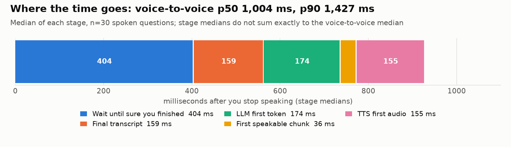
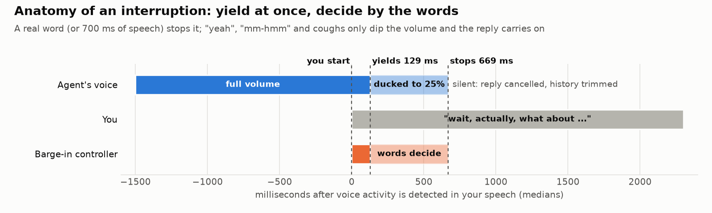
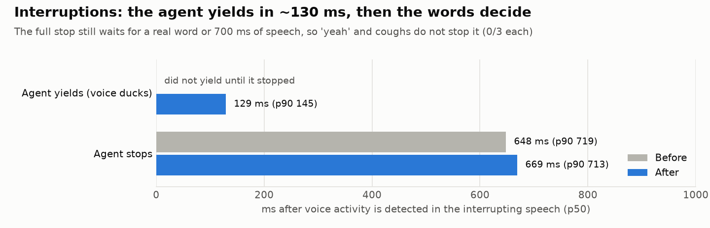
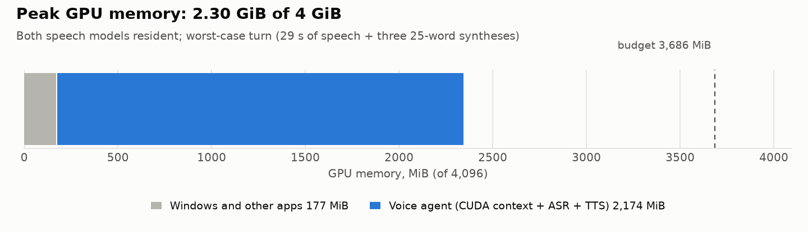
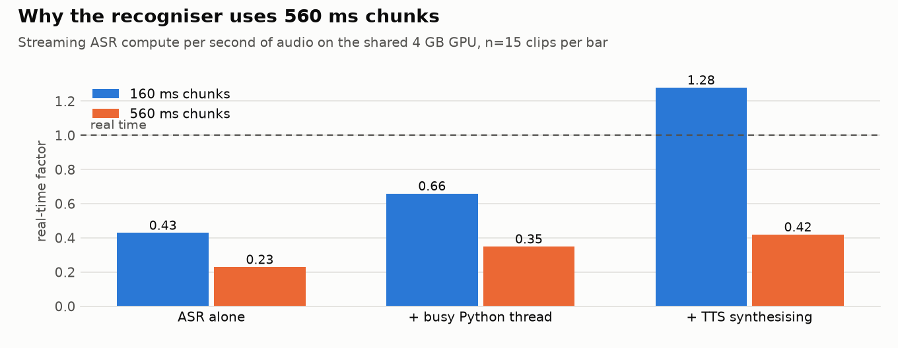
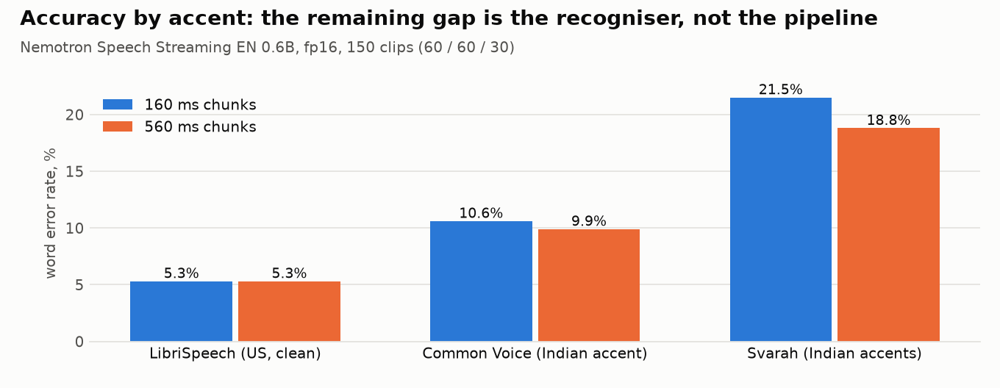

# Benchmarks

Everything here was measured on one laptop with the scripts in [`scripts/`](../scripts). Numbers are medians (p50) and 90th percentiles (p90) with the sample size stated. They describe this machine and this network, not a general claim.

## Setup

| | |
|---|---|
| GPU | NVIDIA RTX 3050 Laptop, 4 GB, SM clock locked at 1,500 MHz (`nvidia-smi -lgc`), 75-87 °C under load |
| System | Windows 11, Python 3.12, PyTorch 2.14 (CUDA 12.6), Transformers 5.22 |
| ASR | Nemotron Speech Streaming EN 0.6B, fp16, 560 ms chunks |
| TTS | Kokoro-82M, voice `af_heart` |
| LLM | Llama 3.3 70B via OpenRouter (Groq, then CoreWeave), from India |
| Speech data | 150 public clips: 60 Common Voice clips by Indian-accent speakers (one per speaker), 60 AI4Bharat Svarah clips across mother tongues (CC BY 4.0), 30 LibriSpeech clips (clean US read speech). None of it is the author's voice. |

**Method.** `scripts/run_eval.py` replays each clip through a real session at real time (endpointing depends on the clock), one fresh session per clip, warm-up excluded. Conditions in a comparison run on the same clips, interleaved (A, B, A, B; in blocks of five when a condition needs different models loaded). Word error rate (WER) ignores case and punctuation. "Last word missing" and "first word missing" are word-overlap checks, so a mishearing ("Lehrer" -> "Layer") or a spelling variant ("tyre"/"tire", "Mr."/"Mister") also counts; they are upper bounds on truncation.

## Headline results

<picture><source media="(prefers-color-scheme: dark)" srcset="assets/latency-breakdown-dark.png"></picture>

| Voice-to-voice (end of user speech to first agent audio), n=30 | p50 | p90 |
|---|---|---|
| First working version | 1,106 ms | 1,635 ms |
| Released defaults | **1,004 ms** | **1,427 ms** |

Three runs of the released defaults gave p50 1,004-1,093 ms and p90 1,394-1,496 ms; differences under about 100 ms between conditions are within run-to-run noise.

<picture><source media="(prefers-color-scheme: dark)" srcset="assets/before-after-dark.png"> 1,004 ms, p90 1,635 -> 1,427 ms; last word missing 30% -> 23%; sentence split 27% -> 17%; WER 9.7% -> 8.9%" src="assets/before-after-light.png"></picture>

<picture><source media="(prefers-color-scheme: dark)" srcset="assets/barge-timeline-dark.png"></picture>

<picture><source media="(prefers-color-scheme: dark)" srcset="assets/interruption-dark.png"></picture>

| Interruptions (scripted: an answer is interrupted 1 s or 3 s in) | Before | After |
|---|---|---|
| Agent audibly yields (volume ducks), p50 / p90 | did not yield | **129 / 145 ms** |
| Agent stops, p50 / p90 | 648 / 719 ms | 669 / 713 ms |
| Stopped by "yeah" / "mm-hmm" / "okay" | 0 of 3 | 0 of 3 |
| Stopped by a cough | 0 of 3 | 0 of 3 |
| Interrupting speech transcribed (WER, 71 words) | 12.7% | 9.9-14.1% across runs |

Times are from the moment voice activity is detected in the interrupting speech. The stop deliberately waits for a real word or 700 ms of speech so that acknowledgements do not stop the agent. In the owner's first live session, stops took 0.7-3.3 s because the recogniser had fallen behind; that cause is fixed (see ASR below).

<picture><source media="(prefers-color-scheme: dark)" srcset="assets/vram-dark.png"></picture>

## Speech recognition

<picture><source media="(prefers-color-scheme: dark)" srcset="assets/asr-contention-dark.png"></picture>

The recogniser shares one GPU and one Python interpreter with the TTS, the web server and WebRTC. At 160 ms chunks it fell behind real time as soon as TTS synthesised, which in live use queued up to 53 s of audio. Three fixes together removed that: 560 ms chunks, purging queued audio of a discarded utterance instead of decoding it, and pausing new TTS syntheses while the user talks over the agent.

<picture><source media="(prefers-color-scheme: dark)" srcset="assets/accent-wer-dark.png"></picture>

| Recogniser on its own | Result |
|---|---|
| Real-time factor at 560 ms, ASR alone | p50 0.13-0.15 over 150 clips (`bench_asr.py`); 0.23 over 15 clips in the contention test above, which resets and flushes per clip |
| End-of-turn flush, recogniser fed like the pipeline (150 clips) | right last word 126/150 with 1 flush chunk, 130/150 with 2, 131/150 with 1.5 s of silence (ideal) |
| Interrupting speech, word by word (12 trials) | complete; every flagged "missing" word was a mishearing or spelling variant the recogniser also makes offline |

The remaining accuracy gap is accent, not the pipeline: about 5% WER on clean US speech, 10% on Indian-accented read speech and 19-21% on Svarah. Svarah mixes read and spontaneous speech and its transcripts write numbers as digits, so part of that is label style.

## Speech synthesis

| Kokoro-82M, chunk length | first audio p50 | p90 |
|---|---|---|
| 4 words | 106 ms | 156 ms |
| 8 words | 153 ms | 206 ms |
| 25 words | 262 ms | 331 ms |

n=30 per length; real-time factor 0.035-0.053.

## Language model

<picture><source media="(prefers-color-scheme: dark)" srcset="assets/llm-ttft-dark.png">CoreWeave 0.20/0.24 s; Llama 3.3 70B @ CoreWeave 0.37/0.48; GPT-OSS 20B 0.49/0.73; GPT-OSS 120B @ Groq 0.52/3.73; DeepSeek V4.1 Flash 0.86/3.91" src="assets/llm-ttft-light.png"></picture>

`scripts/bench_llm.py`: persona, a 6-exchange history and a new user line, streamed, max 90 tokens, conditions interleaved, 20-40 requests each. Provider routing mattered more than model size: the same 70B model was 0.20 s via Groq and 0.37 s via CoreWeave, and default routing of the 8B had a 5.5 s p90.

## Smaller components

| Component | Measured |
|---|---|
| Silero VAD | 0.32 ms per 32 ms frame (n=182), CPU |
| Smart Turn v3.2 | 61 ms p50, 70 ms p90 per call (n=20), CPU; finished sentence 0.98, cut mid-sentence 0.01 |
| Shared link (Cloudflare tunnel, WebSocket audio) | agent audio back 408 ms after the question audio ended (one trial; session voice-to-voice 805 ms); largest playback gap 86 ms with the adaptive jitter buffer, versus 200-250 ms gaps unbuffered |

## What was tried

Each row compared conditions on the same inputs; "kept" means it is the default now.

| Change | Result | Kept |
|---|---|---|
| One long-lived ASR decode thread | removed ~1.7 s of per-turn cuDNN re-planning | yes |
| 2 CPU threads for torch | ASR RTF 0.75 -> 0.52 | yes |
| Lock GPU clocks | ASR RTF at 160 ms 1.14 -> 0.77 | yes (setup step) |
| GPU keep-alive load to raise clocks | RTF 0.85 -> 1.5-3.8 (time-slicing) | no |
| 560 ms ASR chunks | real-time under TTS load (RTF 0.42 vs 1.28); WER 9.1% vs 9.5% | yes |
| 1,120 ms ASR chunks | WER within noise, +48 ms, one new false stop on "yeah" | no |
| Earliest commit at 300 ms silence (vs 150) | splits 27% -> 20%, v2v p50 1,154 -> 962 ms | yes |
| Stricter turn model (complete prob 0.85) | splits 23%, v2v 1,039 ms | no |
| Re-decode the whole turn on resume | words at the pause no longer lost | yes |
| Whole turn to the recogniser + 2 flush chunks + tail counted against the pause | last word missing 27% -> 23%, +50 ms | yes |
| Listening VAD threshold 0.4 (vs 0.5) | slightly worse WER and splits | no |
| Duck after 150 ms of speech (vs 250) | duck 219 -> 135 ms, no extra false stops | yes |
| 500 ms backchannel window (vs 700) | stop 200 ms sooner but 2/3 backchannels stopped the agent | no |
| Barge-in VAD threshold 0.5 (vs 0.6) | no difference | no |
| Llama 3.3 70B with provider order (vs 8B) | same speed, better answers | yes |
| Hedged LLM fallback after 0.8 s | removes the 7.5 s all-timeouts failure seen live | yes |
| WebSocket audio and events through the tunnel | shared link works from any network | yes |

## Reproduce

```powershell
python scripts\fetch_eval_audio.py                       # public test speech (Svarah needs its terms accepted on Hugging Face)
python scripts\run_eval.py --set listening --n 30 --tag mine
python scripts\run_eval.py --set interruptions --n 3 --tag mine_barge
python scripts\run_eval.py --set listening --n 30 --tag chunk --compare asr.chunk_ms=560 --compare asr.chunk_ms=1120
python scripts\bench_tts.py ; python scripts\bench_llm.py ; python scripts\bench_coresident.py
python scripts\plot_results.py                           # redraws docs/assets from docs/results.json
```

Results go to `evals/results/<tag>.md` and `.jsonl` (not committed).

## Limits of these numbers

- One laptop, one network, public read speech. The author's own accent has not been measured yet (`scripts/record_utterances.py` records a personal set).
- Interruption figures rest on a few trials per condition (6 real interruptions, 3 backchannels, 3 coughs); treat differences of a few percent or tens of milliseconds as noise.
- The speaker-echo case (laptop speakers, no headphones) is not handled: with echo cancellation off in the test, the agent stopped for its own voice in 3 of 3 trials.
